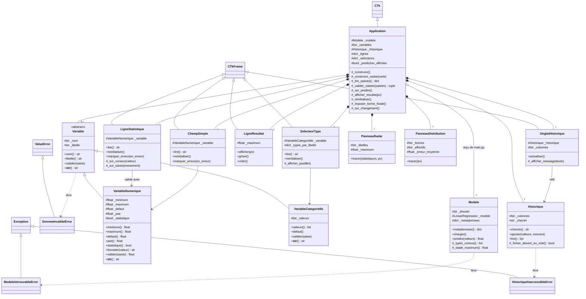

# Diagramme de classes

GitHub affiche ce diagramme directement (format Mermaid).

Notation : `+` public, `#` protégé (nom qui commence par `_` en Python),
`<<abstract>>` classe abstraite, méthode en *italique* = abstraite.

Liens :

- flèche à triangle vide : **héritage** (« est un ») ;
- losange plein : **composition** (« contient et crée ») ;
- losange vide : **agrégation** (« contient, mais reçu de l'extérieur ») ;
- flèche simple : **association** (« utilise ») ;
- flèche pointillée : **dépendance** (« lève » une exception).

## À retenir pour l'oral

- **Héritage** : `VariableNumerique` et `VariableCategorielle` héritent de la
  classe abstraite `Variable` et redéfinissent chacune `valider()` et
  `__str__()` (polymorphisme). Les widgets héritent de CustomTkinter
  (`CTk` pour la fenêtre, `CTkFrame` pour les blocs).
- **Composition** : `Application` crée et contient ses variables, son
  historique et tous ses widgets. Le `Modele` est une **agrégation** : il est
  chargé dans `main.py` puis donné à `Application`.
- **Exceptions** : chaque classe de la logique lève sa propre exception ;
  l'interface les attrape pour afficher un message au lieu de planter.
- **Hors diagramme** : `main.py`, `predicteur.py` et les fonctions
  (`creer_variable()`, `sauvegarder_modele()`, `chronometre`…) ne sont pas
  des classes.
